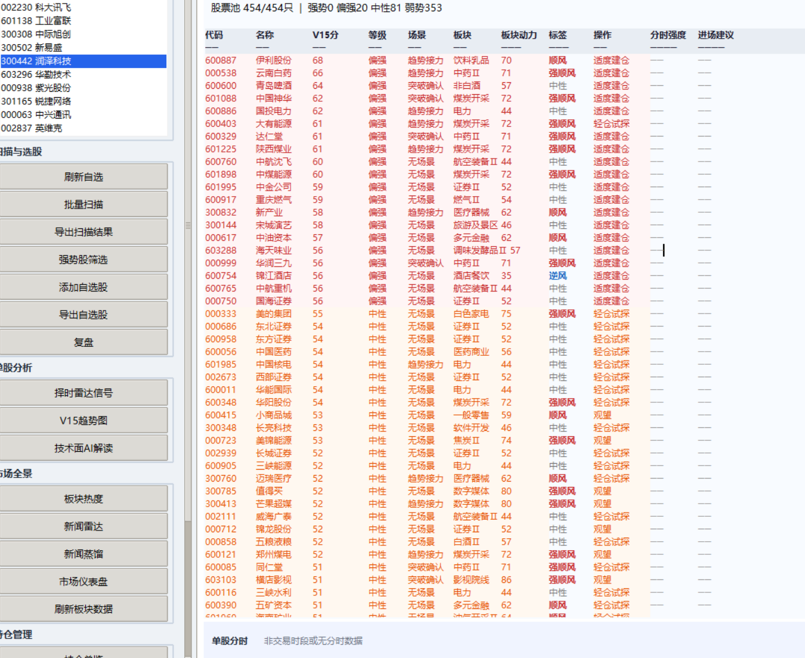
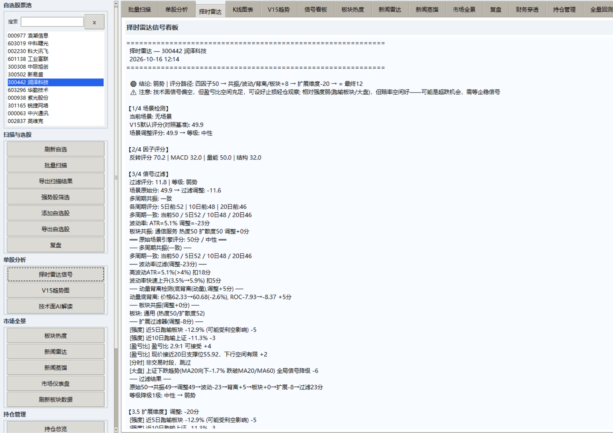
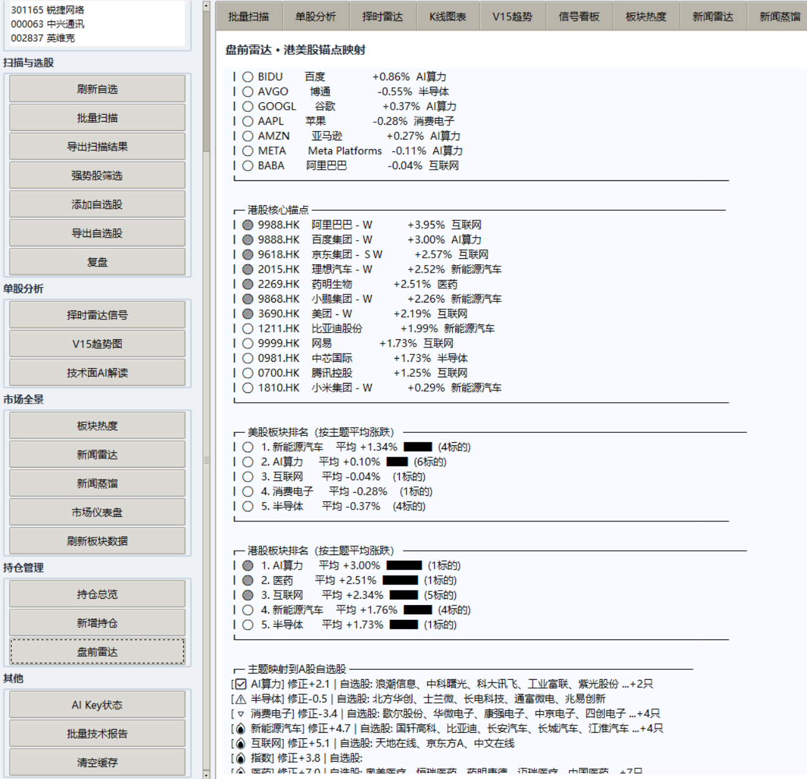
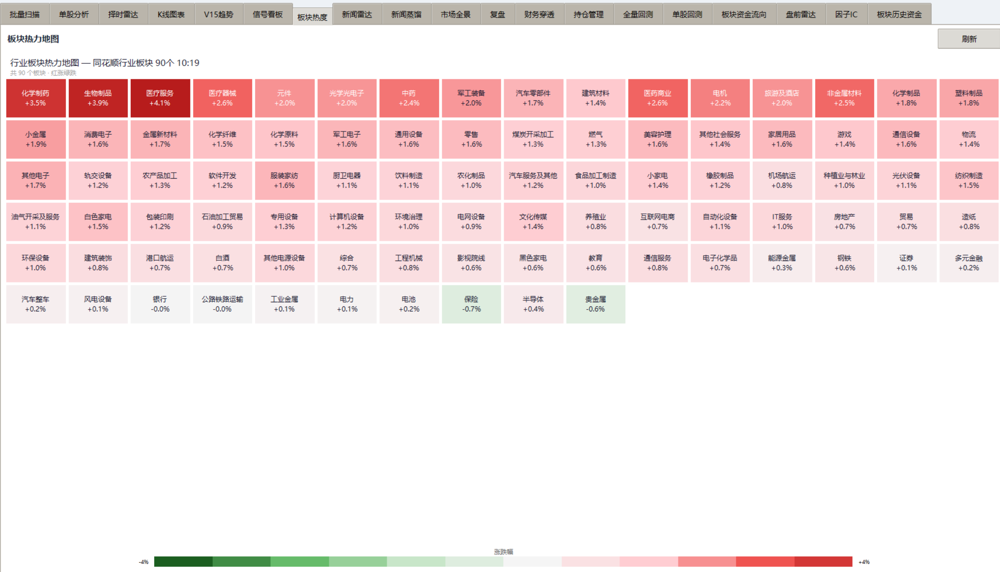

# V15Plus 量化选股系统

一套面向 A 股的**多因子量化选股与择时系统**，包含评分引擎、场景识别、多层过滤、
板块动力分析、新闻情绪量化、组合优化与自动虚拟交易，并带有完整的 Tkinter 图形界面。

> ⚠️ 本项目仅供**学习与研究**使用，不构成任何投资建议。股市有风险，入市需谨慎。
> 作者不对任何人的盈亏负责。

## 界面预览

**信号看板** —— 扫描股票池，按 V15 评分输出可操作信号（等级 / 场景 / 板块动力 / 进场建议）：



**择时雷达** —— 单只个股的四因子 / 场景 / 过滤全链路拆解：



**盘前雷达** —— 隔夜外围市场与板块映射：



**板块热力图** —— 行业板块涨跌与资金分布：



## 特性

- **四因子核心评分**：反转 / MACD / 量能 / 安全结构，权重可配置
- **场景识别**：超跌反弹 / 趋势接力 / 突破确认，按场景动态调整因子权重
- **多层过滤**：多周期共振、MACD/动量背离、波动率、板块共振、扩展五维
- **Plus+ 增强层**：资金流过滤、ATR 调节、多周期共振、新闻情绪量化
- **板块动力评分**：资金占比 + 量能 × 赔率系数
- **信号追踪**：SQLite 记录信号并回填次日命中率
- **组合优化**：凯利分配、行业集中度、止损监控
- **自动虚拟交易**：纯本地模拟 + AI 解读（可选）
- **Tkinter GUI**：18 个功能 Tab，结论前置、可读性优先

## 安装

需要 **Python 3.11+**（GUI 使用标准库 tkinter，无需额外安装）。

```bash
git clone https://github.com/attacklee2022-sketch/V15Plus-Quant.git
cd V15Plus-Quant
pip install -r requirements.txt
```

## 快速开始

```bash
python start.py
```

首次启动会在项目根目录创建 `self_stock.txt`。编辑它即可维护自选股，每行格式为 `代码 名称`：

```
600519 贵州茅台
000858 五粮液
300750 宁德时代
```

仓库内自带一份脱敏示例自选股与示例持仓（`portfolio.json`、`data/auto_account.json`），
均为演示数据，可直接替换。

## 配置

核心评分与 GUI **开箱即用**，无需任何配置即可运行选股与回测。

需要 **AI 分析**、**云端同步/推送** 等功能时，通过环境变量配置（详见
[docs/CONFIGURATION.md](docs/CONFIGURATION.md)）：

```bash
cp .env.example .env
# 编辑 .env 填入你自己的密钥
```

> 所有密钥均通过环境变量读取，源码中不含任何真实凭证。请勿把 `.env` 提交到仓库。

## 项目结构

```
V15Plus-Quant/
├── start.py                    GUI 启动入口
├── _internal/                  V15 核心引擎
│   ├── v15_scorer.py           四因子评分
│   ├── v15_scenario_engine.py  场景识别
│   ├── v15_filter.py           过滤引擎（多周期/背离/波动率/板块）
│   ├── v15_filter_extras.py    扩展五维过滤
│   ├── v15_position_manager.py 仓位建议 + 止盈止损
│   ├── v15_portfolio.py        持仓跟踪与盈亏
│   ├── v15_sector_fetcher.py   板块实时数据
│   ├── v15_sector_history.py   板块历史数据
│   ├── v14_*.py                行情/技术评分/形态/分时/跨市场/新闻
│   └── report_html.py          HTML 报告
├── _plus_/                     Plus+ 增强层（fail-safe 插件）
│   ├── plus_pipeline.py        增强管线（包装 V15）
│   ├── fund_flow_filter.py     资金流过滤
│   ├── multi_tf_resonance.py   多周期共振
│   ├── sentiment_quant.py      新闻情绪量化
│   ├── sector_power.py         板块动力评分
│   ├── signal_tracker.py       信号追踪（SQLite）
│   ├── news_distiller.py       新闻蒸馏
│   ├── portfolio_optimizer.py  组合优化
│   ├── auto_trader.py          自动虚拟交易
│   └── cloud_sync.py           云端同步（HMAC 签名）
├── scripts/                    GUI 与各类脚本
│   ├── stock_gui_V14.py        主 GUI（18 个 Tab）
│   ├── daily_scan.py           每日自动扫描
│   ├── backtest_all.py         全量回测
│   ├── backtest_factor_ic.py   因子 IC 诊断
│   ├── collect_realtime.py     实时行情采集
│   └── ...
├── data/                       数据目录（含脱敏示例）
├── docs/                       文档
└── tasks/                      Windows 计划任务脚本
```

## 评分管道

```
四因子(rev/macd/vol/safe) → 场景权重调整 → 多周期共振过滤
→ MACD/动量背离检测 → 波动率过滤 → 板块共振过滤
→ 扩展五维 → [Plus+] 资金流 + ATR-T1调节 + 多周期共振 + 情绪量化
→ 仓位建议(止盈止损)
```

详见 [docs/ARCHITECTURE.md](docs/ARCHITECTURE.md)。

## 文档

- [配置指引](docs/CONFIGURATION.md) — 环境变量与密钥怎么配
- [部署指引](docs/DEPLOYMENT.md) — 云端采集 / 上传 / 推送架构怎么搭
- [架构说明](docs/ARCHITECTURE.md) — 评分管道与模块职责

## 免责声明

本项目是个人量化学习项目，所有策略、评分、信号仅供研究与技术交流，**不构成投资建议**，
不保证任何收益。使用者需自行承担全部风险。项目中的行情数据来自第三方公开接口，
其准确性、及时性与可用性由数据源决定，作者不做任何担保。

## License

[MIT](LICENSE)
